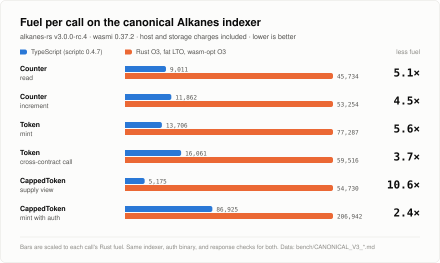

# alkanes-ts

Bitcoin smart contracts in TypeScript.

```ts
import { Contract, state, method, view, type u128 } from "../../sdk/authoring.ts";

export default class Counter extends Contract {
  static readonly incomingAssets = "reject";
  @state({ key: "/count" }) private count: u128 = 0n;

  @method({ opcode: 1 })
  increment(by: u128): u128 {
    this.count += by;
    return this.count;
  }

  @view({ opcode: 2, abiName: "get_count" })
  getCount(): u128 { return this.count; }
}
```

> [!WARNING]
> alkanes-ts is an experiment. The contracts pass behavioral tests and run
> through the unmodified Alkanes indexer, but no transaction has been broadcast
> to a live Bitcoin network and determinism has not been audited. Don't deploy
> anything that holds value. See [Findings](docs/FINDINGS.md).

alkanes-ts writes [alkanes](https://github.com/kungfuflex/alkanes-rs) contracts
as TypeScript classes and compiles them ahead of time to WebAssembly with
[scriptc](https://github.com/vercel-labs/scriptc). There is no JavaScript
engine in the output: each contract is a small Wasm module the indexer runs
like any Rust contract, and on the canonical indexer it burns several times
less fuel than optimized Rust.

<picture>
  <source media="(prefers-color-scheme: dark)" srcset="docs/assets/fuel-dark.svg">
  
</picture>

## Highlights

- **Plain classes:** `@state` fields persist, `@method` and `@view` set the
  opcodes, `@init` runs once. u128 operators are checked, views can't write,
  dispatch is static, and every contract gets a typed client with
  deployment and call plans.
- **No engine in the output:** scriptc compiles the contract and its runtime to
  Wasm. The build fails unless the final module imports only `env` and
  exports only `memory`, `__execute`, and `__meta`.
- **Less fuel than Rust:** 2.4–10.6× less than Rust O3/LTO plus wasm-opt on
  alkanes-rs v3.0.0-rc.4, host and storage charges included. Blocks index
  6–28% faster.
- **Smaller binaries:** 70–93 KB per contract including the scriptc runtime,
  against 123–134 KB for the optimized Rust twins.
- **Tested on the real indexer:** CappedToken and the custody contracts run
  through the unmodified upstream indexer with deployment envelopes, the
  upstream auth token, real UTXO balances, and rollback.

## Quick start

Requires Node.js 24+ and [Zig](https://ziglang.org) on `PATH`.

```console
$ npm install
$ npm run build              # every contract, or: npm run build -- counter
dist/counter.wasm  85430 bytes (41013 gzipped), initialized snapshot ...
$ npm test                   # compiler, client, and Wasm host-model tests
```

To add a contract, create `contracts/<name>/index.ts` with a default-exported
`Contract`, then run `npm run build -- <name>`. The
[authoring guide](docs/AUTHORING.md) covers the semantics, generated clients,
and current limits.

With Rust installed, run a contract under wasmi, the engine the indexer uses:

```console
$ npm run check:wasmi -- dist/counter.wasm --meta 0 1,5 2 3
[1,5]  fuel=5749      ok alkanes=0 [] data=05000000000000000000000000000000 u128=5
[3]  fuel=4721      REVERT "Error: intentional failure"
```

Point `ALKANES_RS` at an alkanes-rs checkout to run the canonical-indexer tests
and benchmarks; see [Benchmarks](docs/BENCHMARKS.md#running-them).

## How it works

An alkane is a Wasm module that exports `__execute` and `__meta` and calls host
functions in `env`. scriptc emits a WASI reactor with its own callback
convention instead, so the build merges in a hand-written adapter and
deterministic WASI stand-ins, then shrinks the result:

```
contracts/<name>/index.ts ── Alkanes frontend ─┐
sdk/*.ts ──────────────────┴─ scriptc --lib ─► contract.wasm
                                                 │
shim/adapter.wat  (alkanes env.* ⇄ scriptc) ─────┤ wasm-merge
shim/wasi.wat     (deterministic WASI) ──────────┘
                                                 │
                   wasm-metadce + wasm-opt -Oz (wasmi-compatible features)
                                                 │
                                    dist/<name>.wasm
```

A thrown `Error` reverts the way `alkanes-runtime` does, and the indexer rolls
the call back. [Architecture](docs/ARCHITECTURE.md) has the details.

## Example contracts

| Contract | What it shows |
|---|---|
| [`counter`](contracts/counter) | Persistent state, rollback on throw, block height, logging |
| [`token`](contracts/token) | An owned fungible alkane on the explicit SDK, with a cross-contract call |
| [`capped-token`](contracts/capped-token) | `@init`, auth-token minting under a fixed cap, tracked assets |
| [`amm-pool`](contracts/amm-pool) | A constant-product pool whose LP shares are its own alkane |
| [`amm-router`](contracts/amm-router) | Exact-input swaps through one or two pools |
| [`share-vault`](contracts/share-vault) | A share vault over one underlying alkane |
| [`timelock-treasury`](contracts/timelock-treasury) | Two-step authenticated withdrawals behind a timelock |

## Documentation

- [Authoring](docs/AUTHORING.md): the contract frontend, clients, and limits
- [Architecture](docs/ARCHITECTURE.md): the build pipeline, shims, and layout
- [Benchmarks](docs/BENCHMARKS.md): methodology, commands, and every saved report
- [Findings](docs/FINDINGS.md): what compiles, fuel, speed, size, and open questions
- [CappedToken](docs/CAPPED_TOKEN.md), [initialization snapshot](docs/SNAPSHOT.md),
  [fixed-width lowering](docs/WORD_LOWERING.md), and
  [Counter/Token details](docs/EXAMPLES_OPTIMIZATION.md)

The package is private; `@alkanes/contract` is the proposed public entry point.
