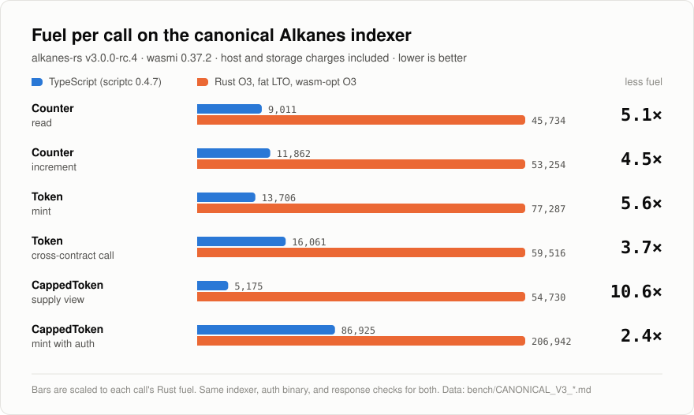

# Benchmarks



The chart above is generated by `npm run bench:art` from the rc.4 reports
([Counter/Token](../bench/CANONICAL_V3_EXAMPLES.md),
[CappedToken](../bench/CANONICAL_V3_CAPPED_TOKEN.md)). Rerun it after
refreshing either report.

## Toolchain

Requirements: Node.js 24+, [Zig](https://ziglang.org) on `PATH` (the current reports use 0.17.0). Zig links scriptc output and builds the fixed-width Wasm SDK. Rust is needed for the standalone wasmi check and canonical-runtime integration/benchmarks; see [CappedToken setup](CAPPED_TOKEN.md#verification-and-benchmarking).

The compiler, `@scriptc/runtime-wasm32-wasi`, and `@scriptc/types` are pinned together at **0.4.10**. Saved benchmark reports record the toolchain used for each measurement; the canonical-indexer reports below were measured with 0.4.7 and have not been rerun. The [0.4.10 report](../bench/SCRIPTC_0410_RESULTS.md) compares the two releases, and the current build, on the in-repo wasmi host model.

## Reports

The SDK uses arithmetic ASCII hex encoding, two-limb u128 codecs and direct u32 byte writes. See the [production before/after fuel report](../bench/SDK_OPTIMIZATION_RESULTS.md) for the measured savings against the previous codecs.

Counter removes string-keyed opcode dispatch and has an exact numeric fast path for its sum loop. The [speed comparison](../bench/SPEED.md) measures both fuel and execution time against Rust, including a Rust build given the same numeric optimization.

The [frontend fuel comparison](../bench/FRONTEND_FUEL_RESULTS.md) records the new class implementation against `3762cad`; the [frontend Rust comparison](../bench/FRONTEND_SPEED_RESULTS.md) measures it against both original and matched numeric Rust implementations.

The [CappedToken optimization comparison](../bench/CAPPED_TOKEN_OPTIMIZATION_RESULTS.md) runs the original bigint representation, the new fixed-width lowering, and unchanged optimized Rust through the actual Alkanes indexer. [Compiler/SDK isolation](../bench/CAPPED_TOKEN_ISOLATION_RESULTS.md) separates compilation, startup and execution and tests SDK algorithm alternatives. [Fixed-width lowering](WORD_LOWERING.md) explains the supported subset and the C helpers compiled into the same metered Wasm module. scriptc still compiles the contract methods. [Integration results](../integration/RESULTS.md) record the upstream revision and hashes; the [first CappedToken benchmark](../bench/CAPPED_TOKEN_RESULTS.md) remains a historical baseline.

In the [current canonical comparison](../bench/CANONICAL_STACK_SIZE_RESULTS.md) (scriptc 0.4.7, alkanes-rs f9446fd, 30 measured runs), authenticated mint uses 82,045 fuel versus 197,787 for Rust O3/LTO plus wasm-opt O3. The supply view uses 4,008 versus 51,454 and indexes in 11.8 ms versus 16.0 ms. Counter and Token use 4–6× less fuel than optimized Rust and index 14–16% faster. The earlier reports below were measured on an Apple M3 Max with scriptc 0.4.0. Fresh deployment timing includes chain bootstrap and does not establish isolated initializer speed.

The [Counter/Token runtime comparison](../bench/EXAMPLES_RUNTIME_RESULTS.md) uses the same canonical indexer, complete response/storage checks and actual UTXO balances. Counter's Rust baseline has the same numeric sum fast path as TS; both Rust O3/LTO and Rust plus wasm-opt O3 are measured. [Verification results](../integration/EXAMPLES_RESULTS.md) include ownership rejection, wide values and nested rollback.

## Running them

```console
$ npm install
$ npm run build              # every contract in contracts/, or: npm run build -- counter
dist/amm-pool.wasm  88409 bytes (41320 gzipped), initialized snapshot ...
dist/capped-token.wasm  73532 bytes (36760 gzipped), initialized snapshot ...
dist/counter.wasm  88942 bytes (42246 gzipped), initialized snapshot ...
dist/token.wasm  96616 bytes (45357 gzipped), initialized snapshot ...
$ npm test                   # rebuild, compiler/client tests, and Wasm host-model tests
$ ALKANES_RS=/path/to/alkanes-rs npm run test:runtime
$ ALKANES_RS=/path/to/alkanes-rs npm run bench:capped -- --iterations 30
$ ALKANES_RS=/path/to/alkanes-rs npm run test:examples
$ ALKANES_RS=/path/to/alkanes-rs node integration/run.mjs --custody   # adds AmmPool, AmmRouter, ShareVault, TimelockTreasury
$ npm run build:bench:examples
$ ALKANES_RS=/path/to/alkanes-rs npm run bench:examples -- --iterations 30 --baseline dist/examples-before
$ npm run check:wasmi -- dist/counter.wasm --meta 0 1,5 2 3
loaded dist/counter.wasm (88942 bytes) under wasmi 0.37.2
__meta  fuel=369       { "contract": "Counter", ... }
[0]  fuel=4161      ok alkanes=0 [] data=
[1,5]  fuel=4764      ok alkanes=0 [] data=05000000000000000000000000000000 u128=5
[2]  fuel=3374      ok alkanes=0 [] data=05000000000000000000000000000000 u128=5
[3]  fuel=3943      REVERT "Error: intentional failure"
```

Each argument to `check:wasmi` is one call, given as comma-separated u128 inputs with the opcode first, optionally followed by an incoming parcel such as `@2:11=1000+2:12=4000`. `--deploy block:tx=other.wasm` adds contracts for cross-contract calls. Storage and alkane balances persist between calls. This harness counts instruction fuel only, without the canonical host and storage charges.
